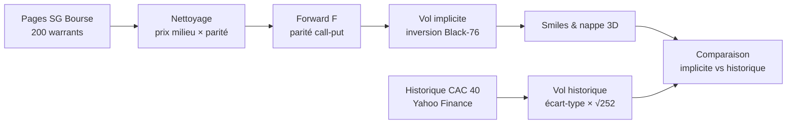
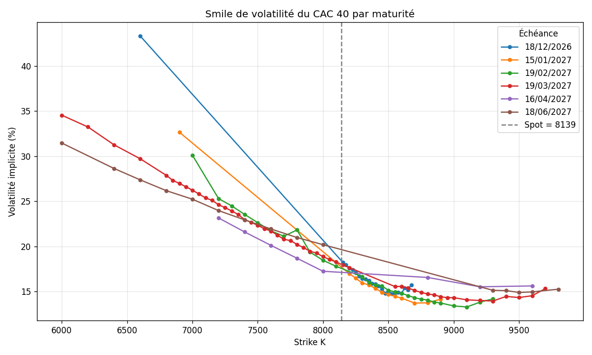
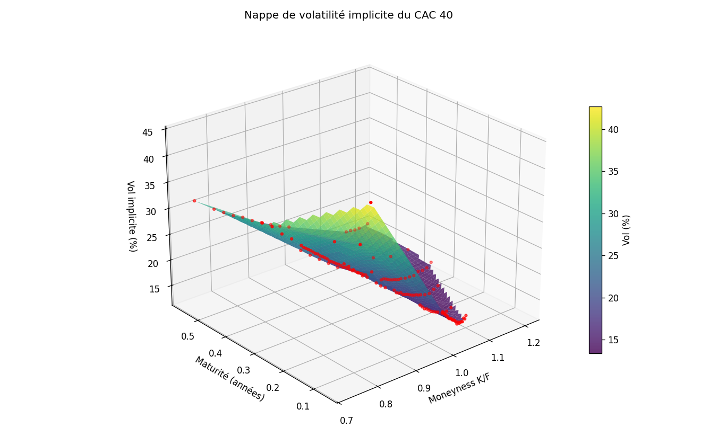
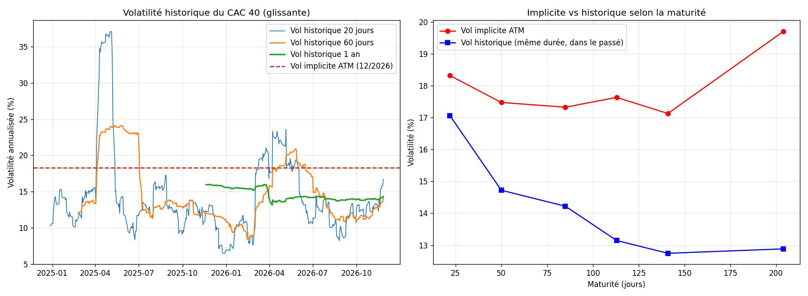

# Nappe de volatilité implicite du CAC 40

> Exercice annexe au PFE (semaine du 23/11/2026), à la demande de l'encadrant : construire une **nappe de volatilité implicite** à partir de prix de **warrants vanille** récupérés sur le site de SG Bourse, puis la **comparer à la volatilité historique** du CAC 40.

Données relevées le **26 novembre 2026**, spot du CAC 40 ≈ **8 139 points**.

📄 **Fiche de synthèse complète :** [`fiche_latex/fiche_nappe_vol.pdf`](fiche_latex/fiche_nappe_vol.pdf)

---

## Sommaire

1. [Ce qu'il faut retenir](#ce-quil-faut-retenir)
2. [Organisation du dossier](#organisation-du-dossier)
3. [Méthode](#méthode)
4. [Résultats](#résultats)
5. [Lancer le script](#lancer-le-script)
6. [Limites](#limites)

---

## Ce qu'il faut retenir

| # | Constat |
| :-: | :--- |
| 1 | La **volatilité implicite** est le $\sigma$ qui, mis dans la formule de Black-76, redonne le prix observé sur le marché. |
| 2 | Elle **dépend du strike et de la maturité** (smile / skew, nappe en 3D) : l'hypothèse de vol constante de Black-Scholes est donc fausse. |
| 3 | Les **puts loin sous le forward ont une vol plus élevée** (25 à plus de 40 %) : le marché paie pour se protéger des krachs. |
| 4 | La vol implicite est **toujours au-dessus de la vol historique** (de +1 à +7 points) : c'est la **prime de volatilité**. |

## Organisation du dossier

```text
nappe_vol_cac40/
├── nappe_vol_simple.py        # Script principal : lecture → forward → vol implicite → graphiques
├── requirements.txt           # Dépendances Python
├── donnees/
│   ├── sg_cac40_calls.html    # Tableau SG Bourse enregistré : 100 warrants call
│   └── sg_cac40_puts.html     # Tableau SG Bourse enregistré : 100 warrants put
├── resultats/                 # Graphiques produits par le script
│   ├── 1_smiles.png
│   ├── 2_nappe_3d.png
│   └── 3_vol_historique_vs_implicite.png
├── fiche_latex/               # Fiche de synthèse (source LaTeX + PDF compilé)
│   ├── fiche_nappe_vol.tex
│   ├── fiche_nappe_vol.pdf
│   └── figures/
└── exploration/               # Scripts brouillons des premiers essais de scraping
    ├── extraction_html_json.py
    └── verif.py
```

## Méthode



**1. Données et nettoyage**
- 200 warrants SG sur le CAC 40 (100 calls, 100 puts), avec 6 échéances de décembre 2026 à juin 2027.
- Prix d'une option sur l'indice : prix milieu $\frac{\text{achat} + \text{vente}}{2}$ multiplié par la **parité** (un warrant 200:1 vaut 1/200 d'option).
- On retire les warrants cotés 0,01 à 0,02 € (prix trop arrondi) et les échéances à moins de 7 jours.
- On ne garde que les options **hors de la monnaie** (puts avec $K < F$, calls avec $K > F$), dont le prix est fait presque entièrement de valeur temps.

**2. Forward par la parité call-put** (dividendes inclus, sans hypothèse)

$$C - P = e^{-rT}(F - K) \quad\Longrightarrow\quad F = K + e^{rT}(C - P)$$

On fait la moyenne sur les 3 strikes communs les plus proches du spot, avec $r$ = 2,5 %. Quand aucun strike n'est commun, on se rabat sur $F = S e^{(r-q)T}$ avec $q$ = 2,8 %.

**3. Black-76 et volatilité implicite**

$$C = e^{-rT}\big[F N(d_1) - K N(d_2)\big], \qquad d_1 = \frac{\ln(F/K) + \tfrac12\sigma^2T}{\sigma\sqrt{T}}, \quad d_2 = d_1 - \sigma\sqrt{T}$$

Le $\sigma$ implicite est obtenu numériquement par la méthode de Brent (`scipy.optimize.brentq`) entre 1 % et 200 %. La solution est unique car le vega est positif.

**4. Volatilité historique**

$$R_t = \ln\frac{P_t}{P_{t-1}}, \qquad \sigma_{\text{hist}} = \text{écart-type}(R_t)\times\sqrt{252}$$

Elle est calculée en glissant sur 20 jours, 60 jours et 1 an, puis sur une durée égale à chaque maturité pour la comparer à la vol implicite à la monnaie (ATM).

## Résultats

### Forwards obtenus

| Échéance | Forward $F$ | Méthode |
| :--- | ---: | :--- |
| 18/12/2026 | 8 145 | parité call-put |
| 15/01/2027 | 8 160 | parité call-put |
| 19/02/2027 | 8 180 | parité call-put |
| 19/03/2027 | 8 204 | parité call-put |
| 16/04/2027 | 8 129 | secours : $S e^{(r-q)T}$ |
| 18/06/2027 | 8 125 | secours : $S e^{(r-q)T}$ |

### Smile par maturité



Calls au-dessus du forward ≈ 14–15 %, à la monnaie ≈ 17–18 %, puts loin sous le forward de 25 % à plus de 40 %. La courbe penche vers la gauche : c'est le **skew** typique d'un indice actions.

### Nappe de volatilité



Le skew est plus marqué sur les échéances courtes et s'aplatit avec la maturité. Les points rouges sont les vols de marché, la surface est une interpolation linéaire (`griddata`) qui n'extrapole pas en dehors des points observés.

### Implicite contre historique



| Échéance | Jours | Vol implicite ATM | Vol historique | Écart (pts) |
| :--- | ---: | ---: | ---: | ---: |
| 18/12/2026 | 22 | 18,3 % | 17,1 % | +1,2 |
| 15/01/2027 | 50 | 17,5 % | 14,7 % | +2,7 |
| 19/02/2027 | 85 | 17,3 % | 14,2 % | +3,1 |
| 19/03/2027 | 113 | 17,6 % | 13,1 % | +4,5 |
| 16/04/2027 | 141 | 17,1 % | 12,7 % | +4,4 |
| 18/06/2027 | 204 | 19,7 % | 12,9 % | +6,8 |

### Pricer avec la vol historique ? (échéance mars 2027, $\sigma_{\text{hist}}$ = 13,1 %)

| Warrant | Prix marché | Vol implicite | Prix avec vol historique | Écart |
| :--- | ---: | ---: | ---: | ---: |
| Put 7000 | 0,385 € | 26,2 % | 0,015 € | −96 % |
| Put 7600 | 0,755 € | 21,7 % | 0,219 € | −71 % |
| Put 8000 | 1,225 € | 18,9 % | 0,736 € | −40 % |
| Call 8600 | 0,665 € | 15,6 % | 0,477 € | −28 % |
| Call 9000 | 0,205 € | 14,3 % | 0,152 € | −26 % |

Tous les warrants valent plus cher sur le marché qu'avec la vol historique : c'est la prime de volatilité, vue en euros. L'écart est énorme sur les puts loin sous le forward, ce qui revient à voir le skew en euros. On price donc avec la **nappe implicite**, pas avec la vol historique.

## Lancer le script

```powershell
pip install -r nappe_vol_cac40/requirements.txt
```

```powershell
python nappe_vol_cac40/nappe_vol_simple.py
```

Le script lit les deux fichiers de `donnees/`, affiche dans la console les forwards et le tableau implicite/historique, puis enregistre les graphiques dans `resultats/`. Il peut être lancé depuis n'importe quel dossier.

Pour l'historique, il utilise `yfinance` (ticker `^FCHI`, 2 ans). Si vous n'avez pas internet, déposez un fichier `donnees/cac40_historique.csv` avec les colonnes `Date` et `Close`. Comme Yahoo Finance met ses données à jour, les vols historiques peuvent varier d'un dixième de point d'un lancement à l'autre.

> Les scripts de `exploration/` sont des brouillons des premiers essais de scraping (sur des pages BNP et SG). Ils attendent des fichiers `*_raw.html` qui ne sont pas versionnés, et ils ne sont pas nécessaires au calcul.

## Limites

1. **Warrants plutôt qu'options listées** : les prix incluent la marge de Société Générale. On mesure donc la vol telle que SG la cote.
2. **Données incomplètes** : l'export SG est limité à 100 lignes par fichier, d'où très peu de puts sur décembre et janvier.
3. **Dividende supposé** pour avril et juin, faute de parité call-put possible. Ces forwards sont approximatifs, car le CAC 40 verse surtout ses dividendes en mai–juin.
4. **Vol ATM de juin probablement surestimée** : elle est interpolée entre un put à 8000 et un call à 9300.
5. **Nappe sans modèle** : simple interpolation linéaire. En pratique, on ajusterait un modèle paramétrique (par exemple **SVI**) pour obtenir une surface lisse et sans arbitrage.
